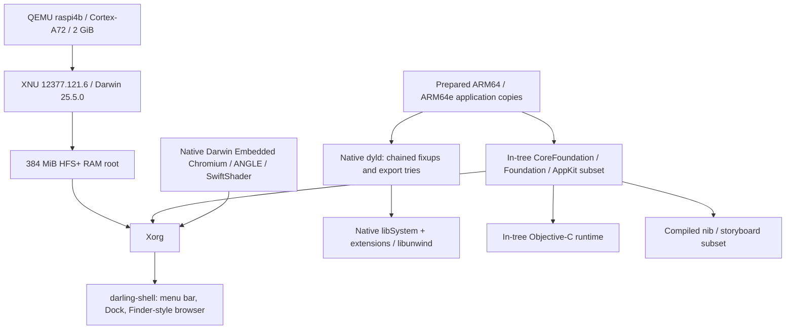

# Architecture, measured status and remaining work

This plan describes the current source and the local launch survey. The evidence
index is [docs/apps/current-status.md](docs/apps/current-status.md); baseline
checks are recorded in [docs/validation.md](docs/validation.md). A startup window
is not a claim of complete application compatibility.

## Architecture

The desktop uses the in-tree shell, rather than an active Xfce window manager
or panel. Xfce/GTK libraries remain in the upstream base image. Cocoa here is
an independent implementation; the upstream Darling checkout supplies
`sw_vers.c`, not a complete Darling framework stack.

## Reading the measurements

The baseline suite checks the CLI, desktop menus/Dock, FastDMG's nib and
preference binding, the ScriptExec text/progress demos, WidgetGallery and native
Chromium side by side. The separate app survey attempts every recursive local
bundle, including nested helpers, and all four source app configurations.
Each row records the original executable hash, staging scope, bounded launch
observation, serial log and raw screenshot.

The RAM-root limit prevents complete staging of the largest bundles. Limited
probes retain the launcher, bundled Mach-O libraries that fit, and selected
resources within a 250 MiB staging budget. An omitted bundled
framework is a **test provisioning limit**; it does not establish that the
original app bundle lacks that framework. Helper launches in isolation can
also miss their containing app's context. Missing metadata/executables are
recorded as packaging problems. No window from a background service is not,
by itself, a compatibility failure.

Main-executable import reports measure exports present in the baseline guest.
They do not measure selector implementations or API behavior, and do not
resolve a full bundle's `@rpath`/runtime-opened dependency closure. The loader
already contains permissive framework fallbacks, and Objective-C/framework code
has stubs. Successful loading, a high symbol percentage, or a rendered window
therefore cannot establish functional compatibility.

## Work still needed in Darling

The following is remaining platform work, not changes made during this survey.
The exact first observed errors for each local binary are in its launch log and
main-executable import report. Later blockers remain untested when startup stops
earlier.

1. **General Cocoa startup and documents.** Complete storyboard initial
   controllers, nib classes/outlets, resource/localization formats (`.loctable`,
   asset catalogs), application lifecycle and document opening. Implement real
   `NSDocument`/`NSDocumentController`, RTF/RTFD storage, Open/Save panels,
   undo, printing, responder/key-view tracking and text input. Existing fallback
   views and no-op selectors are insufficient for complete Apple apps.
2. **Remove existing app-specific behavior through general implementations.**
   The nib loader injects Stickies text and color; the XPC proxy supplies migration
   replies. AppKit invokes `showProgress`, `openAllDocuments`, developer-tool
   installation requests or `SUStatusController`, and loads utility-specific
   nib names to force startup windows. These remain unchanged in this refresh.
   The screenshots must not be presented as proof of real notes, updates,
   installation, Bluetooth transfers or hardware configuration.
3. **Foundation/CoreFoundation and runtime coverage.** Implement the missing
   exported classes/functions and the logged Objective-C methods with correct
   semantics: collections, dates/formatters, property lists, notifications,
   KVO/bindings, errors, run-loop sources, timers and threading. Complete
   Objective-C exceptions, weak references, block lifetime and ABI behavior
   needed by newer binaries. The survey also logs `unsupported native Mach-O
   platform`; Books' main executable declares platform 6 in `LC_BUILD_VERSION`
   (measured with `llvm-otool -l`). Supporting those platform/ABI variants and
   their UIKit/private-framework dependencies is additional work. Claude also
   reaches an illegal-instruction trap (`instr=0x08ea7ea9`, exit 132) after its
   bundled libraries load: investigate the instruction-set/ABI assumptions on
   Cortex-A72. PAC stripping and signing do not prove instruction compatibility.
   Keep OS/version availability queries consistent across the APIs. Extend libc++/libSystem (Mach, dispatch, logging,
   XPC and other imported APIs) based on measured imports and runtime failures.
4. **System services.** Implement real launchd/bootstrap/Mach service discovery,
   XPC endpoints, preferences, notifications, sandbox/TCC behavior and per-user
   sessions. CoreServices background agents are not standalone GUI apps. Their
   expected services and launch arguments must be reproduced before validating
   their behavior. Empty framework stand-ins cannot supply these services.
5. **Graphics, fonts and presentation.** Complete CoreGraphics display/window
   capture and drawing, CoreText layout on FreeType/HarfBuzz, QuartzCore layers,
   IOSurface sharing and presentation onto X11. Metal/OpenGL and related GPU
   APIs remain substantial gaps for modern Apple, Qt and Chromium apps.
6. **Swift.** Supply ABI-compatible Swift runtimes, concurrency, standard-library
   overlays and Foundation bridging. SwiftUI (Windows App, modern Apple apps,
   parts of Teams) requires a separate UI implementation; adding
   `libswiftCore` alone will not make these applications work.
7. **Chromium/Electron platform support.** Claude, Codex and Teams components
   need the macOS Chromium platform layer: Mach-port rendezvous, CFRunLoop port
   sources, helpers/process management, AppKit text input, QuartzCore/IOSurface,
   CoreText, Security trust/Keychain, networking and media/device frameworks.
   Running the separately built native Darwin Embedded `headless_shell` does
   not demonstrate that an app's bundled macOS Chromium framework can run.
8. **Device/media/security frameworks.** Apple utilities need meaningful
   implementations of IOBluetooth/OBEX, OpenDirectory, SystemConfiguration,
   GSS/Kerberos, ImageCaptureCore, ColorSync, FolderActionsKit, PCIe expansion
   support and installation/update services. Other Apple apps need AVFoundation,
   CoreMedia/CoreVideo, CoreAudio, WebKit, PDF/image handling, CoreData, Accounts,
   Contacts, location and private framework behavior. Color Meter needs real
   sampling; Image Capture needs device discovery/transfers; Ticket Viewer needs
   Kerberos tickets. A window alone validates none of these functions.
9. **Storage and faithful full-bundle tests.** A disk-backed guest root or another
   supported large filesystem is needed for complete 200 MiB–1.4 GiB bundles,
   their helpers/frameworks/assets and writable application data. Preserve
   symlinks, entitlements/resource layouts and containing-app context; then
   repeat full-bundle startup and feature tests. This survey does not implement
   storage, kernel, loader or framework compatibility fixes.

## Focused follow-up by application family

| Family | Work required beyond any observed startup UI |
|---|---|
| FastDMG | `hdiutil`/DiskImages mounting and document delivery; nib/preferences checks do not mount an image |
| Platypus demos | General task/pipe/run-loop behavior, script dependencies (including `say`), and all interface modes beyond the two demo configurations |
| Stickies and document apps | Replace injected content/migration replies; persistence, attributed text, editing, document lifecycle |
| Color Meter, Image Capture, Bluetooth, directory/ticket/PCIe utilities | Real display/device/directory/security services and missing framework semantics |
| Apple media, productivity and system apps | Swift/SwiftUI where used, private frameworks, media/WebKit/database services, complete document and UI stacks |
| Claude / Codex / Electron helpers | Full bundle storage plus Chromium-on-macOS services, rendering, text and security layers |
| LINE / Qt components | Swift where imported, libc++, Qt Cocoa integration, CoreText, OpenGL/Metal, media and network services |
| Microsoft Teams / Windows App | Swift and SwiftUI plus communication, authentication, remote-desktop/media services; Teams also has Chromium components |
| Nested helpers / CoreServices agents | Parent app resources, launch arguments, XPC/launchd/bootstrap endpoints and background-service validation |
| OBS / balenaEtcher / Zoom historical candidates | These top-level bundles are absent here; supply complete bundles before making current runtime claims |

## Verification sequence for future work

First reproduce an entry with its full bundle and required launch context, then
resolve the first real loader/runtime failure. Verify behavior through an app
operation (save/reopen a document, transfer a file, capture an image, authenticate,
render a page), with logs and screenshots. Repeat regression checks on the
baseline demos. Do not substitute custom UI for the application's behavior or
interpret stub return values as feature support.
