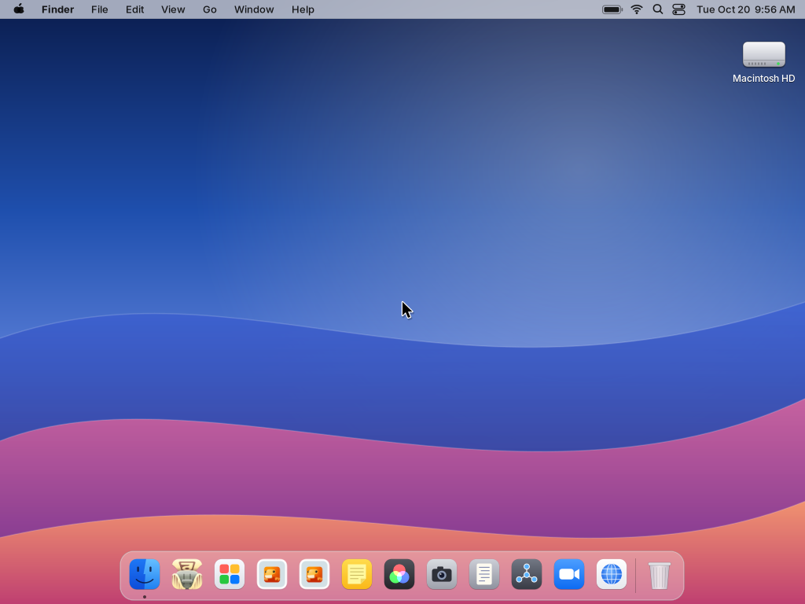

# Darling Embedded

An experimental ARM64 macOS compatibility environment on XNU/Darwin in QEMU.
The in-tree Objective-C runtime, CoreFoundation, Foundation and AppKit subset
render through X11 and Cairo. A desktop shell supplies the menu bar, Dock and
Finder-style application browser. This is an independent Cocoa subset, not a
complete macOS userland or a port of Darling's full framework implementation.

The current app inventory, launch results, raw screenshots and remaining work
are indexed in [docs/apps](docs/apps/README.md). A window appearing is a startup
observation; it does not establish that the app's features work. Failed launches
have framebuffer captures too: a desktop-only image means no app window was
observed, with the reason recorded in the accompanying serial log.



## Build

Build on Linux x86_64 with Bazel 9.1.0, Git/Git LFS, a C++20 host compiler,
Clang/LLVM 20 (including `ld64.lld`, `llvm-lipo`, `llvm-install-name-tool`),
Python 3, the usual native build tools, and OpenSSL development headers.
QEMU needs the `raspi4b` machine (the capture environment uses QEMU 10.1.0).
Screenshots require ImageMagick `convert` or Netpbm `pnmtopng`.

```bash
# Ensure unversioned LLVM tool names are on PATH on Debian/Ubuntu installations.
export PATH=/usr/lib/llvm-20/bin:$PATH
./tools/fetch_demo_apps.sh
bazel build //:all @darwin_embedded//tools/libdmg-hfsplus:hfsplus
bazel run //:verify_arm64 -- --baseline-only
```

`fetch_demo_apps.sh` restores the demo dependencies and verifies their archive
hashes. Supply other app bundles locally. `vendor/` is excluded from Git; optional
bundles absent from it are skipped when building the root image.

The dependencies are pinned in [MODULE.bazel](MODULE.bazel). Optional local
Git caches can be selected using `DARWIN_EMBEDDED_GIT_CACHE` and
`DARLING_GIT_CACHE`; there is no hard-coded checkout or home directory.
The build inherits the invoking environment's `PATH`.

`--baseline-only` exercises CLI tools, the desktop, FastDMG's nib-defined UI
and preference binding, the two Platypus demos, WidgetGallery, and native
Chromium/ANGLE/SwiftShader. Without this flag the historical verification
suite also requires its flat-layout Zoom and Apple utility bundles. For the
current recursive vendor inventory, use the batch capture below. To open a
GTK guest window, use `bazel run //:run_gui -- --baseline-only` (`$DISPLAY`
required). These checks exercise existing functionality; no new Darling
compatibility fixes are part of this status refresh.

## Capture every local app

```bash
deps_dir=bazel-bin/external/+darwin_embedded_repository+darwin_embedded
python3 tools/capture_app_status.py \
  --root bazel-bin/darling-root.arm64.img \
  --loader "$deps_dir/userland/apps/chromium/browser-arm64/boot_current.bin" \
  --kernel "$deps_dir/userland/apps/x11/desktop-arm64/kernel.bin" \
  --layout "$deps_dir/userland/apps/x11/desktop-arm64/kernel_layout.json" \
  --hfs "$deps_dir/tools/libdmg-hfsplus/hfsplus" \
  --signer bazel-bin/macho_sign \
  --resume
```

The host-side runner inventories every `.app` under `vendor/`, including
nested helpers and aliases, plus HelloWorld, WidgetGallery, System Info and
ProgressBar under `apps/`. It stages copies in temporary HFS+ images and
boots QEMU in batches. Original vendor files are not modified. The signer
selects ARM64 and removes pointer authentication for Cortex-A72 before
ad-hoc signing; these are prepared copies, not byte-identical executables.

Each entry has a raw PNG, a launch log, its original executable hash, the
staging scope and observed status in
[results.json](docs/app-results/results.json). The default observation period
is eight seconds per launch. A missing executable or malformed bundle remains
in the report. The root image is RAM-backed: bundles exceeding the runner's
40 MiB complete-copy budget get explicitly labelled probes of their launcher,
bundled Mach-O libraries and selected resources, within a 250 MiB staging budget. Those probes do not verify a full bundle;
missing bundled dependencies can be a staging limitation. Helpers are also
probed individually and may require their containing app's environment.

`--match '<source path substring>'` selects a subset. `--resume` reuses completed
entries whose screenshots still exist; omit it for a fresh run. This is a
bounded startup survey, not a functional or endurance test.

## Components

- [darling/dyld](darling/dyld): native dynamic linker with chained fixups and
  export-trie support, based on Darwin Embedded.
- [darling/objc](darling/objc): Objective-C runtime and ARM64 message dispatch.
- [darling/frameworks](darling/frameworks): Cocoa subset, nib decoding and
  X11/Cairo rendering; many APIs are incomplete or stubs.
- [darling/libSystem](darling/libSystem): runtime additions and libunwind glue.
- [darling/tools](darling/tools): CLI launchers, session supervisor and desktop.
- [apps](apps): source demos and Platypus app settings/scripts.
- [tools](tools): root-image builder, verifier, signer, nib/import inspectors
  and app capture tools.
- [PLAN.md](PLAN.md): architecture and remaining compatibility work.
- [THIRD_PARTY_NOTICES.md](THIRD_PARTY_NOTICES.md): upstream sources and licenses.

The kernel, base libraries, Xorg and native Chromium build are supplied by
[Darwin Embedded](https://github.com/merckhung/darwin_embedded).
[Darling](https://github.com/darlinghq/darling) supplies `sw_vers.c`.

## License

[GPL-3.0-or-later](LICENSE), with component-specific notices in
[THIRD_PARTY_NOTICES.md](THIRD_PARTY_NOTICES.md).
